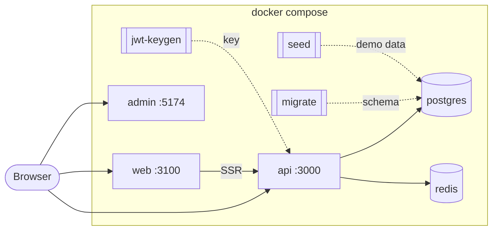

# ecommerce-platform

[](https://github.com/raouf-b-dev/ecommerce-platform/actions/workflows/ci.yml)
[](LICENSE)

One Compose file. Three published apps. A working ecommerce demo on your laptop.

This repo is **configuration only** (a compose platform). The API, admin dashboard, and storefront ship as versioned GHCR images. Design notes: [docs/DESIGN.md](docs/DESIGN.md). Hosted demo operator guide (not deployed yet): [docs/HOSTED-DEMO.md](docs/HOSTED-DEMO.md).

## Hosted demo

Hosted demo: coming soon. Until then, run everything locally with `docker compose up` (see [Run the demo](#run-the-demo)); local sign-in accounts are under [Local demo sign-in](#local-demo-sign-in-demo_read_onlyfalse).

## Run the demo

Needs Docker Desktop (Windows / macOS) or Docker Engine with Compose v2.24+ (Linux), and Git.

```sh
git clone https://github.com/raouf-b-dev/ecommerce-platform.git
cd ecommerce-platform
cp .env.example .env
docker compose up -d --wait
```

With Node.js LTS (see `.nvmrc`, currently 26) and npm 12.2.1 (pinned in `package.json` `devEngines`; no Node release bundles it yet, so run `npm install --global npm@12.2.1` once; see [docs/README.md](docs/README.md#nodejs-version-policy)) (creates `.env`, prints URLs, then starts the stack):

```sh
git clone https://github.com/raouf-b-dev/ecommerce-platform.git
cd ecommerce-platform
npm ci
npm run setup
npm run d:up
npm run d:open
```

First start pulls images (a few minutes). Later starts are about 30 seconds. If the seed image is not on GHCR yet, Compose builds the API `seed` stage from the pinned tag once.

## Open the apps

| What | URL |
| :--- | :-- |
| Storefront | http://localhost:3100 |
| Admin | http://localhost:5174 |
| API | http://localhost:3000 |
| API docs | http://localhost:3000/api/docs |

Or: `npm run d:urls` / `npm run d:open` (ports come from `.env`).

### Local demo sign-in (`DEMO_READ_ONLY=false`)

| Role | Email | Password | App |
| :--- | :---- | :------- | :-- |
| Super admin | `superadmin@store.local` | `SuperAdmin123!` | Admin |
| Admin | `admin@store.local` | `Admin123!` | Admin |
| Customer | `customer@store.local` | `Customer123!` | Storefront |

These accounts are for local Compose only. The hosted demo (coming soon) seeds just a read-only admin viewer (`DEMO_READ_ONLY=true`, `DEMO_VIEWER_*`); it has no demo customer, so shoppers register their own accounts.

Local demo accounts must set a new password at first sign-in. Every local seed reset restores the passwords above. Checkout uses the API mock payment provider (no Stripe / card details).

## Everyday commands

Prefer the npm shortcuts (they ensure `.env` exists and work the same on Windows, macOS, and Linux). Raw `docker compose` is fine too.

| Task | npm | docker compose |
| :--- | :--- | :--- |
| Create / refresh `.env` | `npm run env:init` (`env:init:force` to overwrite) | `cp .env.example .env` |
| Start and wait | `npm run d:up` | `docker compose up -d --wait` |
| Start + Grafana / Prometheus | `npm run d:up:obs` | `docker compose --profile observability up -d --wait` |
| Stop (keep data) | `npm run d:down` | `docker compose --profile '*' down` |
| Wipe data and start fresh | `npm run d:reset` | down `-v`, then up `--wait` |
| Logs (one service) | `npm run d:logs -- api` | `docker compose logs -f api` |
| Status | `npm run d:status` | `docker compose --profile '*' ps -a` |
| Pull pins and restart | `npm run d:update` | `pull` then up `--remove-orphans` |
| Smoke probes | `npm run d:smoke` | (stack must be up) |
| Doctor / pre-PR | `npm run doctor` / `npm run pr` | |

`make` mirrors the same tasks if you prefer it. `migrate`, `seed`, and `jwt-keygen` showing `Exited (0)` is expected (one-shot jobs).

If `docker compose pull` says `denied`, run `docker login ghcr.io` with a token that can read `raouf-b-dev` packages (or wait until the package is public).

### Observability

`npm run d:up:obs` then open Grafana http://localhost:3001 (`admin` / `admin` from `.env`) and Prometheus http://localhost:9090.

## Architecture



Startup: postgres + redis + jwt-keygen → migrate → seed → api (healthy) → admin + web. Browsers use `http://localhost:3000`; storefront SSR uses `http://api:3000` inside Compose.

App sources (not in this repo):

| App | Repository |
| :-- | :--------- |
| API | [ecommerce-store-api](https://github.com/raouf-b-dev/ecommerce-store-api) |
| Admin | [ecommerce-admin-dashboard](https://github.com/raouf-b-dev/ecommerce-admin-dashboard) |
| Web | [ecommerce-store-web](https://github.com/raouf-b-dev/ecommerce-store-web) |

## Versions

Pins live in [`versions.json`](versions.json) and are mirrored into `.env.example` / this matrix via `npm run sync-pins` or `npm run bump -- <api|admin|web> <x.y.z>`.

| Component | Variable | Pinned | Image | Release |
| :-------- | :------- | :----- | :---- | :------ |
| API | `ECOM_API_VERSION` | 0.13.0 | [ecommerce-store-api](https://github.com/raouf-b-dev/ecommerce-store-api/pkgs/container/ecommerce-store-api) | [v0.13.0](https://github.com/raouf-b-dev/ecommerce-store-api/releases/tag/v0.13.0) |
| Admin dashboard | `ECOM_ADMIN_VERSION` | 0.8.0 | [ecommerce-admin-dashboard](https://github.com/raouf-b-dev/ecommerce-admin-dashboard/pkgs/container/ecommerce-admin-dashboard) | [v0.8.0](https://github.com/raouf-b-dev/ecommerce-admin-dashboard/releases/tag/v0.8.0) |
| Storefront | `ECOM_WEB_VERSION` | 0.7.0 | [ecommerce-store-web](https://github.com/raouf-b-dev/ecommerce-store-web/pkgs/container/ecommerce-store-web) | [v0.7.0](https://github.com/raouf-b-dev/ecommerce-store-web/releases/tag/v0.7.0) |

To upgrade: bump the pin, then `npm run d:update`. Downgrade needs a data reset (`npm run d:reset`) because migrations are not rolled back.

## Configuration

Every variable is documented in [.env.example](.env.example). Missing keys fail loud in Compose.

Personal overrides: copy [`overrides/compose.override.example.yaml`](overrides/compose.override.example.yaml) to root `compose.override.yaml` (gitignored). The sample remaps busy host ports; it does not require cloning the API.

Hosted API-tier (VM only, no admin/web containers):

```sh
docker compose -f compose.yaml -f overrides/compose.hosted-api.yaml up -d --wait
```

Details: [docs/HOSTED-DEMO.md](docs/HOSTED-DEMO.md).

## Troubleshooting

**Missing `.env` / required variable** - `npm run env:init` or `cp .env.example .env`.

**Port already in use (or Windows Hyper-V reserve)** - change `API_PORT` / `WEB_PORT` / `ADMIN_PORT` in `.env`, or use the port remap override sample, then `npm run d:up`.

**migrate / seed failed** - `npm run d:logs -- migrate` (or `seed` / `api`). Often fixed with `npm run d:reset`.

**Slow first start** - image pulls (and maybe one seed build). Retry `npm run d:up`.

**Forced password change after login** - expected for demo accounts; seed restores the table passwords on each reset.

**Apple Silicon slow / platform warning** - newer API tags are multi-arch; older ones may be amd64-only under emulation.

## Known limitations

- No hosted demo yet (coming soon); run the stack locally.
- No checkout GIF yet.
- This repo does not host application source or OpenAPI.

## Contributing

See [CONTRIBUTING.md](CONTRIBUTING.md). For app code, open the matching repository above. Security: [SECURITY.md](SECURITY.md).

## License

[MIT](LICENSE)
