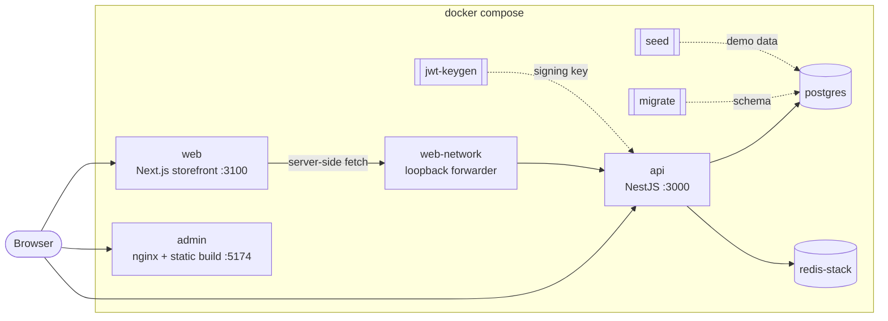

# ecommerce-platform

Run the full ecommerce system (NestJS API, React admin dashboard, Next.js storefront, Postgres, Redis) on your machine with one Docker Compose command. No Node.js install on the host. Admin and storefront come from GHCR; the one-shot seed job still builds once from the pinned API git tag.

This repository holds configuration only. The applications live in their own repositories and are pulled as versioned images:

| App | Repository | Role |
| :-- | :--------- | :--- |
| API | [ecommerce-store-api](https://github.com/raouf-b-dev/ecommerce-store-api) | NestJS modular monolith: catalog, carts, checkout saga, inventory, payments (mock), RBAC |
| Admin | [ecommerce-admin-dashboard](https://github.com/raouf-b-dev/ecommerce-admin-dashboard) | React and Vite operator dashboard |
| Web | [ecommerce-store-web](https://github.com/raouf-b-dev/ecommerce-store-web) | Next.js App Router storefront |

## Quick start

Requirements: Docker Desktop (Windows, macOS) or Docker Engine with the Compose plugin v2.24 or later (Linux), and Git. The same commands work in PowerShell and in bash.

```sh
git clone https://github.com/raouf-b-dev/ecommerce-platform.git; cd ecommerce-platform
cp .env.example .env
docker compose up -d --wait
```

The last command returns once every service is healthy and the demo data is loaded. Later starts take about 30 seconds. The first start pulls images and builds the seed job from the pinned API tag (a few minutes on a typical connection).

## URLs and demo accounts

| What | URL |
| :--- | :-- |
| Storefront | http://localhost:3100 |
| Admin dashboard | http://localhost:5174 |
| API | http://localhost:3000 |
| API docs (Swagger) | http://localhost:3000/api/docs |
| API health | http://localhost:3000/health |

| Role | Email | Password | Use it in |
| :--- | :---- | :------- | :-------- |
| Super administrator | `superadmin@store.local` | `SuperAdmin123!` | Admin dashboard |
| Administrator | `admin@store.local` | `Admin123!` | Admin dashboard |
| Customer | `customer@store.local` | `Customer123!` | Storefront |

These accounts come from the API demo seed ([seeding guide](https://github.com/raouf-b-dev/ecommerce-store-api/blob/master/docs/development/SEEDING.md)). Each one must choose a new password at first sign-in. The seed runs on every start and resets these three accounts to the passwords above.

Checkout uses the API mock payment provider: an order moves from `pending_payment` to `confirmed` a few seconds after checkout, with no card details or Stripe account.

## Architecture



Startup order, each step gated on the previous one being healthy or finished:

1. `postgres` and `redis` start; `jwt-keygen` creates a demo RS256 signing key in the `jwt_keys` volume on first start.
2. `migrate` applies the API database migrations and exits.
3. `seed` loads the demo catalog, users, carts, orders and payments and exits. It is idempotent.
4. `api` starts and reports healthy on `/health/readiness` (Postgres and Redis reachable).
5. `admin` and `web` start.

The browser calls the API directly at `http://localhost:3000`, as both frontends are designed to. The storefront also renders on the server and calls the same URL from inside its container; the `web-network` container forwards that loopback port to the API.

## Commands

| Task | Command | Make shortcut |
| :--- | :------ | :------------ |
| Start and wait for health | `docker compose up -d --wait` | `make up` |
| Stop, keep data | `docker compose --profile '*' down` | `make down` |
| Reset: delete data, migrate and seed again | `docker compose --profile '*' down -v --remove-orphans` then `docker compose up -d --wait` | `make reset` |
| Follow logs | `docker compose logs -f` (one service: `docker compose logs -f api`) | `make logs` or `make logs s=api` |
| Pull pinned versions and restart | `docker compose pull --ignore-pull-failures` then `docker compose up -d --wait --remove-orphans` | `make update` |
| Status and health | `docker compose --profile '*' ps -a` | `make status` |
| Observability (Prometheus, Grafana) | `docker compose --profile observability up -d --wait` | `make observability` |

`make` is optional. On Windows, run the `docker compose` commands directly in PowerShell. In Windows PowerShell 5.1, run two-step commands one after the other rather than joining them with `&&`.

The `migrate`, `seed` and `jwt-keygen` services show as `Exited (0)` in the status output. That is expected: they are one-shot jobs.

### Observability

```sh
docker compose --profile observability up -d --wait
```

| What | URL | Login |
| :--- | :-- | :---- |
| Grafana | http://localhost:3001 | `admin` / `admin` (from `.env`) |
| Prometheus | http://localhost:9090 | none |

Prometheus scrapes the API `/metrics` endpoint with the `METRICS_API_KEY` bearer token. Grafana is provisioned with the dashboards from the API repository at the pinned API version. Tracing (Tempo) and log shipping (Loki) from the API's own development stack are not included.

## Version matrix

Versions are pinned in `.env` (copied from `.env.example`).

| Component | Variable | Pinned | Image | Release |
| :-------- | :------- | :----- | :---- | :------ |
| API | `ECOM_API_VERSION` | 0.11.1 | [ghcr.io/raouf-b-dev/ecommerce-store-api](https://github.com/raouf-b-dev/ecommerce-store-api/pkgs/container/ecommerce-store-api) | [v0.11.1](https://github.com/raouf-b-dev/ecommerce-store-api/releases/tag/v0.11.1) |
| Admin dashboard | `ECOM_ADMIN_VERSION` | 0.7.0 | [ghcr.io/raouf-b-dev/ecommerce-admin-dashboard](https://github.com/raouf-b-dev/ecommerce-admin-dashboard/pkgs/container/ecommerce-admin-dashboard) | [v0.7.0](https://github.com/raouf-b-dev/ecommerce-admin-dashboard/releases/tag/v0.7.0) |
| Storefront | `ECOM_WEB_VERSION` | 0.6.0 | [ghcr.io/raouf-b-dev/ecommerce-store-web](https://github.com/raouf-b-dev/ecommerce-store-web/pkgs/container/ecommerce-store-web) | [v0.6.0](https://github.com/raouf-b-dev/ecommerce-store-web/releases/tag/v0.6.0) |

Admin 0.7.0 and web 0.6.0 support API 0.10.0 or later; this stack pins API 0.11.1.

Infrastructure images (Postgres 18.4, Redis Stack 7.2.0-v18, Prometheus, Grafana, socat) are pinned in `compose.yaml` and updated by Dependabot.

## Upgrading

1. Check the release notes of the app you want to upgrade, including which API versions the frontends support.
2. Change the version in `.env` (and in `.env.example` if you are updating this repository).
3. Pull and restart:

   ```sh
   docker compose pull --ignore-pull-failures
   docker compose up -d --wait --remove-orphans
   ```

Migrations run automatically on start. To go back to an older API version, reset the data as well (`docker compose --profile '*' down -v`), because migrations are not rolled back.

## Configuration

Every variable is documented in [.env.example](.env.example). Compose stops with an error that names the variable if one is missing from `.env`.

For personal changes that you do not want to commit (extra ports, resource limits), create `compose.override.yaml`. Compose merges it automatically and Git ignores it.

To build the demo seed from a local API clone instead of the pinned release tag, point `API_SOURCE` at that folder, for example `API_SOURCE=../ecommerce-store-api`, then run `docker compose up -d --wait`.

## Troubleshooting

**`required variable ... is missing a value` or `set ... in .env`**
`.env` is missing or incomplete. Copy it again from `.env.example` (`cp .env.example .env`) or add the named variable.

**`Bind for 0.0.0.0:3000 failed` or `An attempt was made to access a socket in a way forbidden by its access permissions`**
The port is in use or, on Windows, reserved by Hyper-V (check with `netsh interface ipv4 show excludedportrange protocol=tcp`). Change `API_PORT`, `WEB_PORT` or `ADMIN_PORT` in `.env`, then restart with `docker compose up -d --wait` so admin and web pick up the updated `API_BASE_URL`.

**`dependency failed to start` or `service "migrate" didn't complete successfully`**
Run `docker compose ps -a` and `docker compose logs migrate seed api` to see which step failed. A failed migration usually means the volume holds data from a newer API version; reset with `docker compose --profile '*' down -v`.

**The first start is slow or a build fails while downloading packages**
The first start builds the seed job from the pinned API tag (and may pull packages for that build). Check the network connection, then run `docker compose up -d --wait` again; finished build steps are cached.

**Product photos show a letter placeholder in the storefront**
Web 0.6.0 publishes with `NEXT_PUBLIC_ALLOW_LOOPBACK_ORIGIN=true`. If placeholders remain, see [Known limitations](#known-limitations). The admin dashboard and the API (`http://localhost:3000/media/demo/v1/...`) show the photos.

**Sign-in works but the next page asks for a new password**
Expected: demo accounts must change their password at first sign-in. Every restart resets them to the documented passwords.

**Apple Silicon: images run slowly or warn about the platform**
The API image is published for `linux/amd64` only and runs under emulation. Enable Rosetta for x86/amd64 emulation in Docker Desktop settings.

## Known limitations

These come from the current app releases, not from this repository, and are tracked for the app repositories:

- The API image does not include the demo seed script, so the `seed` job builds the API Dockerfile `build` stage from the pinned release tag on first start.
- Demo accounts must change password at first sign-in; every seed reset restores the documented passwords.
- Apple Silicon: the API image is `linux/amd64` and may run under emulation (enable Rosetta in Docker Desktop if needed).

## Development

This repository is for running released versions. To work on an app, clone its repository and follow its README:

- API: [ecommerce-store-api](https://github.com/raouf-b-dev/ecommerce-store-api#readme)
- Admin dashboard: [ecommerce-admin-dashboard](https://github.com/raouf-b-dev/ecommerce-admin-dashboard#readme)
- Storefront: [ecommerce-store-web](https://github.com/raouf-b-dev/ecommerce-store-web#readme)

See [CONTRIBUTING.md](CONTRIBUTING.md) for changes to this repository and [SECURITY.md](SECURITY.md) for reporting vulnerabilities.

## License

[MIT](LICENSE)
