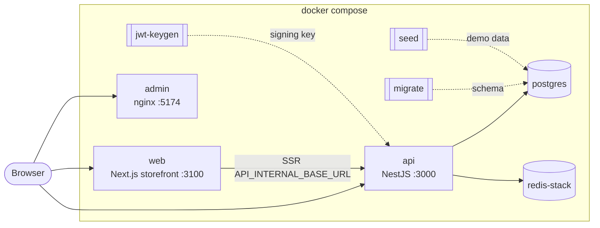

# ecommerce-platform

[](https://github.com/raouf-b-dev/ecommerce-platform/actions/workflows/ci.yml)
[](LICENSE)

One Compose file. Three published apps. A working ecommerce demo on your laptop.

```sh
git clone https://github.com/raouf-b-dev/ecommerce-platform.git
cd ecommerce-platform
cp .env.example .env
docker compose up -d --wait
```

No Node.js on the host for the happy path. API, admin, storefront, and the demo seed job come from GHCR. Pins live in [`versions.json`](versions.json) and stay honest via `npm run check:pins`. Design rationale: [docs/DESIGN.md](docs/DESIGN.md).

This repository holds **configuration only**. Applications live in their own repos:

| App | Repository | Role |
| :-- | :--------- | :--- |
| API | [ecommerce-store-api](https://github.com/raouf-b-dev/ecommerce-store-api) | NestJS modular monolith: catalog, carts, checkout saga, inventory, payments (mock), RBAC |
| Admin | [ecommerce-admin-dashboard](https://github.com/raouf-b-dev/ecommerce-admin-dashboard) | React and Vite operator dashboard |
| Web | [ecommerce-store-web](https://github.com/raouf-b-dev/ecommerce-store-web) | Next.js App Router storefront |

## Quick start

Requirements: Docker Desktop (Windows, macOS) or Docker Engine with the Compose plugin v2.24 or later (Linux), and Git. The same commands work in PowerShell and in bash.

```sh
git clone https://github.com/raouf-b-dev/ecommerce-platform.git; cd ecommerce-platform
cp .env.example .env
docker compose up -d --wait
```

The last command returns once every service is healthy and the demo data is loaded. Later starts take about 30 seconds. The first start pulls images (a few minutes on a typical connection). If the seed image is not on GHCR yet, Compose builds the API Dockerfile `seed` stage from the pinned release tag once.

Optional local gates (Node 24+):

```sh
npm ci
npm run doctor
npm run verify
npm run smoke   # after the stack is up
```

See [CONTRIBUTING.md](CONTRIBUTING.md).

## Try without cloning

A hosted public staging URL is not published yet. When it is, this section will link it. Until then, use Quick start above. A short checkout walkthrough recording may land later under `docs/checkout.gif`.

## URLs and demo accounts

| What | URL |
| :--- | :-- |
| Storefront | http://localhost:3100 |
| Admin dashboard | http://localhost:5174 |
| API | http://localhost:3000 |
| API docs (Swagger) | http://localhost:3000/api/docs |
| API health | http://localhost:3000/health |

| Role | Email | Password | Use it in |
| :--- | :---- | :------- | :-------- |
| Super administrator | `superadmin@store.local` | `SuperAdmin123!` | Admin dashboard |
| Administrator | `admin@store.local` | `Admin123!` | Admin dashboard |
| Customer | `customer@store.local` | `Customer123!` | Storefront |

These accounts come from the API demo seed ([seeding guide](https://github.com/raouf-b-dev/ecommerce-store-api/blob/master/docs/development/SEEDING.md)). Each one must choose a new password at first sign-in. The seed runs on every start and resets these three accounts to the passwords above.

Checkout uses the API mock payment provider: an order moves from `pending_payment` to `confirmed` a few seconds after checkout, with no card details or Stripe account.

## Architecture



Startup order, each step gated on the previous one being healthy or finished:

1. `postgres` and `redis` start; `jwt-keygen` creates a demo RS256 signing key in the `jwt_keys` volume on first start.
2. `migrate` applies the API database migrations and exits.
3. `seed` loads the demo catalog, users, carts, orders and payments and exits. It is idempotent.
4. `api` starts and reports healthy on `/health/readiness` (Postgres and Redis reachable).
5. `admin` and `web` start.

The browser calls the API at `http://localhost:3000`. Storefront SSR calls `http://api:3000` inside the Compose network (`API_INTERNAL_BASE_URL`).

## Commands

| Task | Command | Make shortcut |
| :--- | :------ | :------------ |
| Start and wait for health | `docker compose up -d --wait` | `make up` |
| Stop, keep data | `docker compose --profile '*' down` | `make down` |
| Reset: delete data, migrate and seed again | `docker compose --profile '*' down -v --remove-orphans` then `docker compose up -d --wait` | `make reset` |
| Follow logs | `docker compose logs -f` (one service: `docker compose logs -f api`) | `make logs` or `make logs s=api` |
| Pull pinned versions and restart | `docker compose pull` then `docker compose up -d --wait --remove-orphans` | `make update` |
| Status and health | `docker compose --profile '*' ps -a` | `make status` |
| Observability (Prometheus, Grafana) | `docker compose --profile observability up -d --wait` | `make observability` |
| Pre-PR verify | `npm run verify` | `make verify` |
| Doctor | `npm run doctor` | `make doctor` |
| Smoke (stack must be up) | `npm run smoke` | `make smoke` |
| Bump an app pin | `npm run bump -- api 0.12.0` | `make bump app=api ver=0.12.0` |

`make` is optional. On Windows, run the `docker compose` commands directly in PowerShell. In Windows PowerShell 5.1, run two-step commands one after the other rather than joining them with `&&`.

The `migrate`, `seed` and `jwt-keygen` services show as `Exited (0)` in the status output. That is expected: they are one-shot jobs.

If `docker compose pull` prints `denied` for a GHCR image, log in (`docker login ghcr.io`) with a token that can read packages for `raouf-b-dev`, or use a public package.

### Observability

```sh
docker compose --profile observability up -d --wait
```

| What | URL | Login |
| :--- | :-- | :---- |
| Grafana | http://localhost:3001 | `admin` / `admin` (from `.env`) |
| Prometheus | http://localhost:9090 | none |

Prometheus scrapes the API `/metrics` endpoint with the `METRICS_API_KEY` bearer token. Grafana is provisioned with the dashboards from the API repository at the pinned API version. Tracing (Tempo) and log shipping (Loki) from the API's own development stack are not included.

## Version matrix

Versions are pinned in [`versions.json`](versions.json) and mirrored into `.env` (via `.env.example`).

| Component | Variable | Pinned | Image | Release |
| :-------- | :------- | :----- | :---- | :------ |
| API | `ECOM_API_VERSION` | 0.11.1 | [ghcr.io/raouf-b-dev/ecommerce-store-api](https://github.com/raouf-b-dev/ecommerce-store-api/pkgs/container/ecommerce-store-api) | [v0.11.1](https://github.com/raouf-b-dev/ecommerce-store-api/releases/tag/v0.11.1) |
| Admin dashboard | `ECOM_ADMIN_VERSION` | 0.7.0 | [ghcr.io/raouf-b-dev/ecommerce-admin-dashboard](https://github.com/raouf-b-dev/ecommerce-admin-dashboard/pkgs/container/ecommerce-admin-dashboard) | [v0.7.0](https://github.com/raouf-b-dev/ecommerce-admin-dashboard/releases/tag/v0.7.0) |
| Storefront | `ECOM_WEB_VERSION` | 0.6.0 | [ghcr.io/raouf-b-dev/ecommerce-store-web](https://github.com/raouf-b-dev/ecommerce-store-web/pkgs/container/ecommerce-store-web) | [v0.6.0](https://github.com/raouf-b-dev/ecommerce-store-web/releases/tag/v0.6.0) |

Admin 0.7.0 and web 0.6.0 support API 0.10.0 or later; this stack pins API 0.11.1. The seed job uses `ghcr.io/raouf-b-dev/ecommerce-store-api-seed` at the same API version.

Infrastructure images (Postgres 18.4, Redis Stack 7.2.0-v18, Prometheus, Grafana) are pinned in `compose.yaml` and updated by Dependabot (PRs target `master`).

## Upgrading

1. Check the release notes of the app you want to upgrade, including which API versions the frontends support.
2. Bump the pin: `npm run bump -- api 0.12.0` (or edit `versions.json` and run `npm run sync-pins`).
3. Copy `.env.example` into your local `.env` if needed, then:

   ```sh
   docker compose pull
   docker compose up -d --wait --remove-orphans
   ```

Migrations run automatically on start. To go back to an older API version, reset the data as well (`docker compose --profile '*' down -v`), because migrations are not rolled back.

## Configuration

Every variable is documented in [.env.example](.env.example). Compose stops with an error that names the variable if one is missing from `.env`.

For personal changes that you do not want to commit (extra ports, resource limits, building the seed from a local API clone), copy [`compose.override.example.yaml`](compose.override.example.yaml) to `compose.override.yaml`. Compose merges it automatically and Git ignores it.

## Troubleshooting

**`required variable ... is missing a value` or `set ... in .env`**
`.env` is missing or incomplete. Copy it again from `.env.example` (`cp .env.example .env`) or add the named variable.

**`Bind for 0.0.0.0:3000 failed` or `An attempt was made to access a socket in a way forbidden by its access permissions`**
The port is in use or, on Windows, reserved by Hyper-V (check with `netsh interface ipv4 show excludedportrange protocol=tcp`). Change `API_PORT`, `WEB_PORT` or `ADMIN_PORT` in `.env`, then restart with `docker compose up -d --wait` so admin and web pick up the updated `API_BASE_URL`.

**`dependency failed to start` or `service "migrate" didn't complete successfully`**
Run `docker compose ps -a` and `docker compose logs migrate seed api` to see which step failed. A failed migration usually means the volume holds data from a newer API version; reset with `docker compose --profile '*' down -v`.

**The first start is slow or a build fails while downloading packages**
Pulls and (if needed) the one-time seed image build need network access. Check the connection, then run `docker compose up -d --wait` again; finished build steps are cached.

**Product photos show a letter placeholder in the storefront**
Web 0.6.0 publishes with `NEXT_PUBLIC_ALLOW_LOOPBACK_ORIGIN=true`. If placeholders remain, see [Known limitations](#known-limitations). The admin dashboard and the API (`http://localhost:3000/media/demo/v1/...`) show the photos.

**Sign-in works but the next page asks for a new password**
Expected: demo accounts must change their password at first sign-in. Every restart resets them to the documented passwords.

**Apple Silicon: images run slowly or warn about the platform**
API images published after the seed/multi-arch Docker pipeline change are `linux/amd64` and `linux/arm64`. Older tags such as `0.11.1` may still be amd64-only and run under emulation; enable Rosetta in Docker Desktop if needed.

## Known limitations

- Until `ecommerce-store-api-seed` is published for the pinned API tag, the first start builds the seed stage from the API git tag once.
- Demo accounts must change password at first sign-in; every seed reset restores the documented passwords.
- Hosted staging URL and checkout walkthrough GIF are not shipped yet (see Try without cloning).

## Development

This repository is for running released versions. To work on an app, clone its repository and follow its README:

- API: [ecommerce-store-api](https://github.com/raouf-b-dev/ecommerce-store-api#readme)
- Admin dashboard: [ecommerce-admin-dashboard](https://github.com/raouf-b-dev/ecommerce-admin-dashboard#readme)
- Storefront: [ecommerce-store-web](https://github.com/raouf-b-dev/ecommerce-store-web#readme)

See [CONTRIBUTING.md](CONTRIBUTING.md) for changes to this repository, [docs/DESIGN.md](docs/DESIGN.md) for intentional trade-offs, and [SECURITY.md](SECURITY.md) for reporting vulnerabilities.

## License

[MIT](LICENSE)
